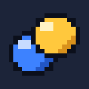
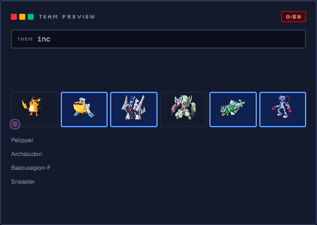
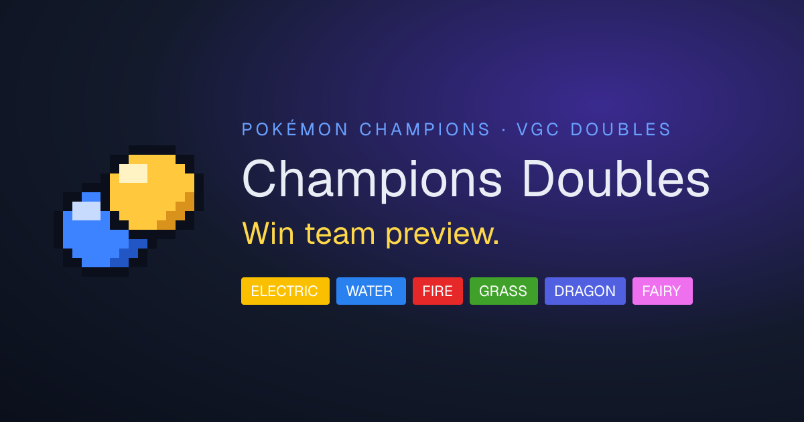
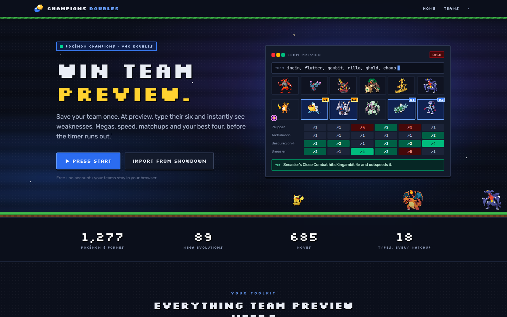
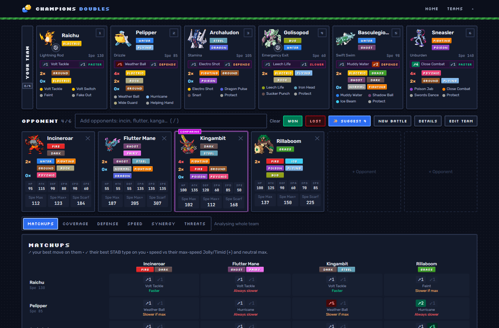
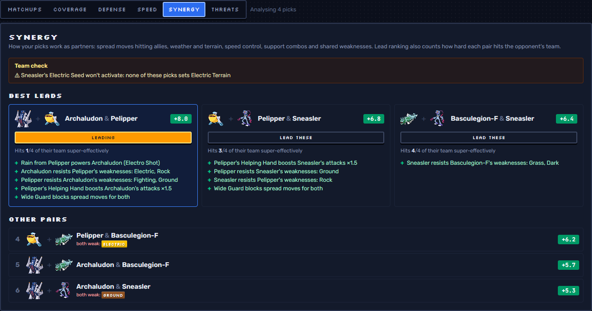
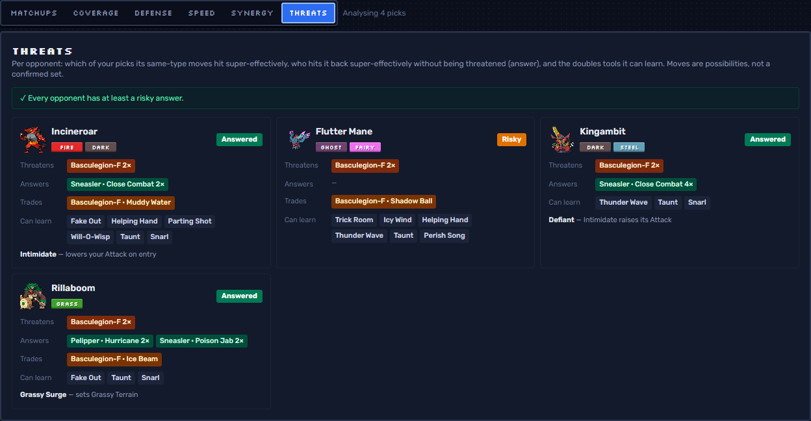
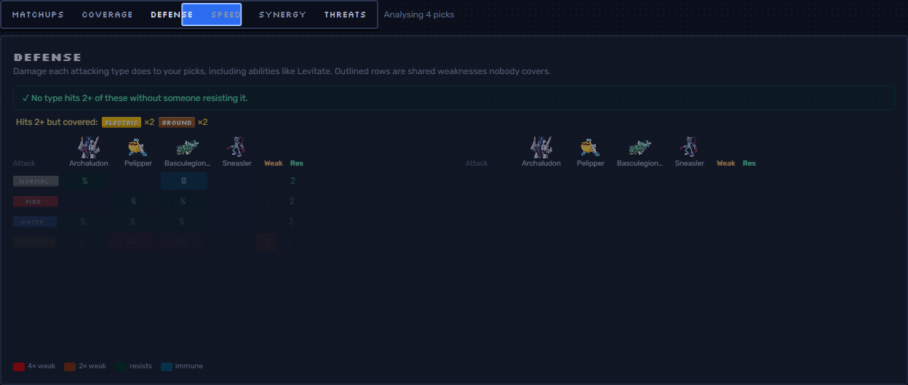
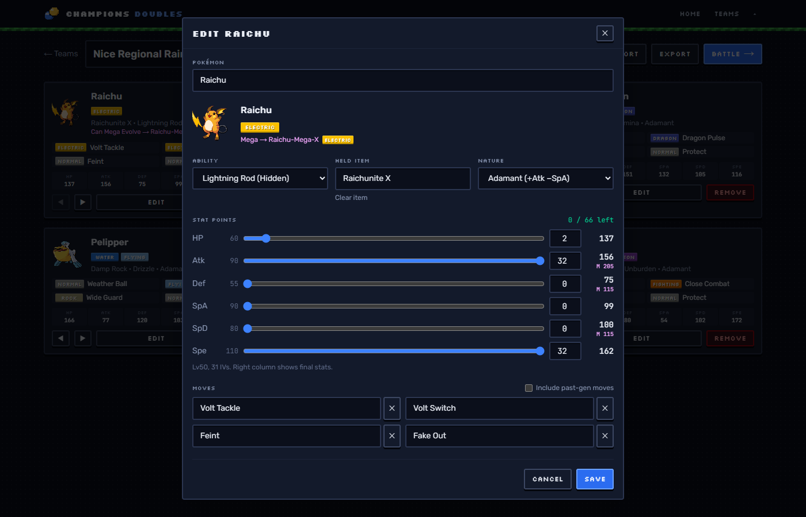
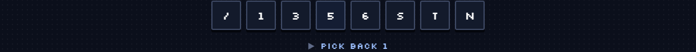

<div align="center">




# CHAMPIONS DOUBLES

### Win team preview.

**A retro, keyboard-first team-preview helper for _Pokémon Champions_ VGC doubles.**<br/>
Save your six once. At preview, type their six and instantly see weaknesses, Megas, speed,<br/>
matchups, synergy and your best four, before the timer runs out.

<br/>


<br/>



<sub>⬆ The landing page's live anime.js demo, recorded from the app</sub>

</div>

---

## ▶ PRESS START

```bash
npm install
npm run dev        # http://localhost:3000
```

| Command | Does |
| --- | --- |
| `npm run dev` | Dev server with hot reload |
| `npm run build` | Production build |
| `npm start` | Serve the production build |
| `npm test` | Unit tests (type chart, stats, coverage, synergy, import…) |
| `npm run lint` | ESLint |

> **No account, no backend.** Teams, settings and your win/loss log live in your browser's `localStorage`, and the whole Pokédex ships with the app, so nothing waits on the network mid-preview. Accounts and cloud sync are planned for a later release.

### 🚀 Deploy

It's a standard Next.js app, so it runs on any Node.js host or platform that supports Next.js.

```bash
NEXT_PUBLIC_SITE_URL=https://your-domain.example npm run build
npm start
```

`NEXT_PUBLIC_SITE_URL` sets the canonical address used by share cards, the sitemap and `robots.txt`; without it they point at `http://localhost:3000`. Players can also **install it to their home screen** (it ships a web manifest and icons), handy at events.

| Built in | |
| --- | --- |
| 🖼️ App icon, Apple touch icon, social share card | generated from the pixel logo (`src/app/icon.tsx`, `apple-icon.tsx`, `opengraph-image.tsx`) |
| 🔎 Page titles & descriptions | `Your teams · Champions Doubles`, `Battle: <team> · Champions Doubles`, … |
| 🗺️ `sitemap.xml`, `robots.txt`, web manifest | `src/app/sitemap.ts`, `robots.ts`, `manifest.ts` |
| ♿ Accessibility | skip link, visible focus ring, labelled controls, full keyboard play, reduced-motion support |
| 🧭 Friendly 404 & error pages | "A wild 404 appeared!" |

<div align="center"></div>

---

## 🎒 MOVESET

> _Champions Doubles learned 10 moves!_

| | Move | Type | Effect |
| :-: | --- | :-: | --- |
| 🛠️ | **Team Builder** |  | Search any Pokémon (typos welcome), pick moves from its real move pool, items, abilities and natures. **Stat Points** sliders follow Champions' rules: 66 total, 32 per stat, Lv50, 31 IVs. |
| 📋 | **Showdown Import** |  | Paste a Showdown team. Champions spreads (`32 Atk / 32 Spe`) are read as SP directly; classic `252/252/4` EVs are converted. Exports back to Showdown too. |
| 🔍 | **Opponent Intel** |  | Type `incin, flutter, gambit` and press Enter. Each opponent shows weaknesses, base stats and Min / Max / Max+ / Scarf speed, plus a warning when an ability like Levitate changes its weaknesses. |
| 💎 | **Mega Stone** |  | Tap the pixel Mega Stone on any sprite to Mega Evolve, including the new Legends Z-A Megas. X/Y Megas cycle Base → X → Y. |
| 🎯 | **Compare** |  | Tap an opponent: every one of your tiles shows your best hit, their strongest same-type hit and who's faster. |
| 🛡️ | **Coverage & Defense** |  | What your four hit super-effectively, plus a defense grid that flags types hitting 2+ of your picks with nobody resisting. |
| 🤝 | **Synergy** |  | Ranks your lead pairs: rain setters with Swift Swim, Earthquake hitting your partner, Fake Out plus setup, Trick Room fit, terrain seeds. **Lead these** in one tap. |
| 👻 | **Threats** |  | Per opponent: *Answered / Risky / No answer*, the support moves it can learn, and traps like Defiant vs your Intimidate. |
| ⚡ | **Suggest 4** |  | Press <kbd>S</kbd> to pick four that cover their team, aren't threatened, and outspeed what they can. |
| 🏆 | **Battle Log** |  | **Won / Lost** logs your picks and their team, then clears the board for the next game. Records show on every team card. |

---

## 📸 POKÉDEX ENTRIES

<table>
  <tr>
    <td width="50%"><br/><sub><b>Landing</b>: pixel starfield, walking sprites, live demo</sub></td>
    <td width="50%"><br/><sub><b>Battle</b>: tap Kingambit, every tile shows the matchup</sub></td>
  </tr>
  <tr>
    <td><br/><sub><b>Synergy</b>: best lead pairs with the reasons why</sub></td>
    <td><br/><sub><b>Threats</b>: who answers what, and what they can learn</sub></td>
  </tr>
  <tr>
    <td><br/><sub><b>Defense</b>: shared weaknesses at a glance</sub></td>
    <td><br/><sub><b>Editor</b>: Stat Points with live final stats</sub></td>
  </tr>
</table>

---

## ⌨️ SPEEDRUN CONTROLS

<div align="center">

</div>

| Key | Action |
| :-: | --- |
| <kbd>/</kbd> | Jump to the opponent search |
| <kbd>Enter</kbd> | Add it (or a whole comma list: `incin, flutter, kanga`) |
| <kbd>Backspace</kbd> | Remove the last opponent (in an empty search box) |
| <kbd>1</kbd> – <kbd>6</kbd> | Pick your Pokémon (first two lead, next two in the back) |
| <kbd>S</kbd> | Suggest the best 4 |
| <kbd>N</kbd> | New battle (undoable) |
| <kbd>D</kbd> | Details on/off |
| <kbd>Q</kbd> <kbd>W</kbd> <kbd>E</kbd> <kbd>R</kbd> <kbd>T</kbd> <kbd>Y</kbd> | Matchups · Coverage · Defense · Speed · Synergy · Threats |
| <kbd>Esc</kbd> | Leave the search box / stop comparing |

---

## ✨ ANIME.JS EFFECTS

Every animation is [anime.js 4](https://animejs.com), kept short (150–450 ms) so nothing slows you down at preview. If your OS has **Reduce motion** turned on, every animation is skipped.

| Effect | Where |
| --- | --- |
| 🎬 Scripted `createTimeline` loop: typing, bouncing sprites, badge pops, Mega flash, matchup grid | Landing hero |
| 🚶 Two-frame overworld walk (`steps(2)`) across a pixel grass strip | Landing |
| 📜 Scroll reveal + counting stats (IntersectionObserver + `stagger`) | Landing |
| ⌨️ Self-playing keyboard timeline | Landing |
| 🃏 Tiles rise in with `stagger`; matrix cells ripple, stat bars grow | Everywhere |
| 🔢 Pick badge springs in (`outBack`), with tiles dipping when picked | Battle |
| 💥 Mega Evolution flash: brightness and twist keyframes on the sprite | Battle |
| 🫥 Opponents shrink out before they're removed | Battle |
| 🧭 Sliding tab indicator | Battle |

---

## 📊 BASE STATS

```
HP   ▰▰▰▰▰▰▰▰▰▱  1,277 Pokémon & formes from Showdown's dex
ATK  ▰▰▰▰▰▰▰▰▱▱  89 Mega Evolutions, new Legends Z-A ones included
DEF  ▰▰▰▰▰▰▰▰▰▱  18×18 type chart + ability immunities (Levitate, Flash Fire, …)
SPA  ▰▰▰▰▰▰▰▱▱▱  685 current moves, full learnsets incl. pre-evolutions
SPD  ▰▰▰▰▰▰▰▰▰▱  zero network calls during a battle
SPE  ▰▰▰▰▰▰▰▰▰▰  every action has a hotkey
```

### Stat Points math

Champions fixes every Pokémon at **Lv50 with 31 IVs** and replaces EVs with **Stat Points**: 66 to spend, at most 32 per stat, and **1 SP = +1 stat** before the nature multiplier.

```ts
// src/lib/stats.ts
const core = Math.floor(((2 * base + 31) * 50) / 100);
hp    = core + 60 + sp;                       // HP
other = Math.floor((core + 5 + sp) * nature); // Atk, Def, SpA, SpD, Spe
```

---

## 🗺️ ROUTE MAP

```
src/
├─ app/
│  ├─ page.tsx                 # landing page
│  ├─ icon.tsx  apple-icon.tsx  opengraph-image.tsx   # generated from the logo
│  ├─ manifest.ts  robots.ts  sitemap.ts  not-found.tsx  error.tsx
│  └─ (app)/                   # working area
│     ├─ teams/                # team list + /teams/[id] editor
│     └─ battle/[teamId]/      # the battle screen
├─ components/
│  ├─ landing/                 # HeroDemo, Walkers, ShortcutDemo, scroll reveal
│  ├─ battle/                  # team & opponent panels, analysis tabs
│  ├─ team/                    # editor, import, cards
│  └─ shared/                  # Sprite, TypeBadge, MegaStone, Combobox, Modal…
├─ lib/                        # pure logic, unit-tested
│  ├─ typechart.ts  coverage.ts  synergy.ts  threats.ts  suggest.ts
│  ├─ stats.ts      showdown.ts  learnset.ts  opponents.ts
│  ├─ motion.ts                # anime.js presets + useAnimateIn
│  └─ logo.ts  site.ts         # pixel logo data, site name/URL/description
└─ store/                      # zustand: teams, battle, history (localStorage)
```

---

## 🎓 CREDITS

- Pokédex, moves, learnsets and type chart: [`@pkmn/dex`](https://github.com/pkmn/ps) (Pokémon Showdown data)
- Showdown paste parsing: [`@pkmn/sets`](https://github.com/pkmn/ps) · sprites: [Pokémon Showdown](https://play.pokemonshowdown.com) via [`@pkmn/img`](https://github.com/pkmn/img)
- Animation: [anime.js](https://animejs.com) · fonts: [Silkscreen](https://fonts.google.com/specimen/Silkscreen), [Rubik](https://fonts.google.com/specimen/Rubik), [JetBrains Mono](https://fonts.google.com/specimen/JetBrains+Mono)

<div align="center">

<br/>


**Ready, trainer?**

<sub>Fan-made project, not affiliated with Nintendo, Game Freak, Creatures or The Pokémon Company.<br/>Pokémon and all related names and sprites are trademarks of their respective owners.</sub>

</div>
